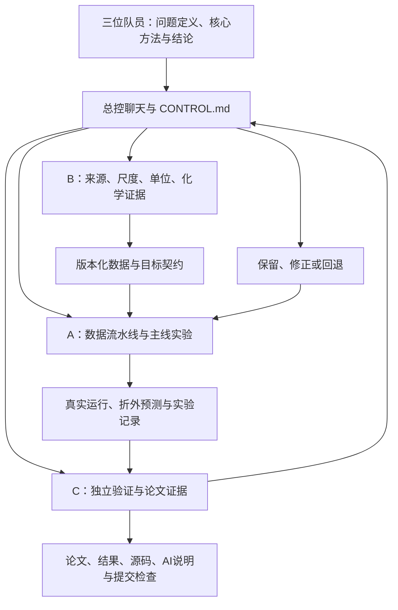

# 整体架构链路 v0.2

本架构服务于三问和可复现交付。先保持少量清楚边界，实践中按证据调整。当前按A主线、B刘源证据、C谢小鱼验收三条工作线组织，入口在workstreams/。已展开的A代码暂留src/tests/scripts，避免为目录整齐打断工作；成果稳定后再集中整理完整项目。

## 运行链路

每个环节均按[工具工作流](TOOL_WORKFLOW.md)执行，实际操作与结果记录是进入下一环节的依据，skill选择和工具能力缺口可追溯。

1. **原始输入**：本地只读附件；每个文件记录SHA-256。
2. **数据契约**：样本键、字段、目标范围、单位/变换、阈值、来源和未知项。
3. **预处理**：按验证划分在训练部分拟合；预测时复用同一变换。
4. **任务模块**：感官预测；相关图与Top-3稳定性；风格条件生成和迁移。
5. **评分与约束适配**：0–6映射和物理阈值独立成边界，缺少证据时输出“不可评价/待核实”，不得默认成功。
6. **统一评价**：按指标版本保存折外/独立结果，包含失败样本、覆盖率与不确定性。
7. **证据与交付**：每个论文数字、图表、结论可指向来源或run_id；C复跑后给出验收状态。

## 文件归属

| 范围 | 主责 | 说明 |
|---|---|---|
| CONTROL.md、AGENTS.md、docs/TEAM_PROTOCOL.md、docs/ARCHITECTURE.md | 总控 | 共同规范只通过明确变更更新 |
| src/、tests/、configs/、scripts/、运行依赖 | A | 主线实现；C提出问题或在自己的分支提供修改建议 |
| docs/A_RUNBOOK.md、reports/A_STATUS.md | A | 运行说明和阶段状态 |
| research/B/、reports/B_STATUS.md | B | 长期来源核查和科学证据 |
| review/、reports/C/、reports/C_STATUS.md | C | 独立检查脚本、验收记录、论文证据表 |
| research/target-dictionary.csv、chemical-units.csv及根部初查报告 | 总控维护的基础证据 | B提出更正，A/C不得无说明覆写 |
| records/ai/A或B或C、records/decisions/ | 各成员分文件写 | 避免多人编辑一个共享大表 |
| runs/、本地原始数据 | 运行者本地保存 | 不自动上传；提交轻量摘要、配置和复现路径 |

## 阶段门槛

- **M0 证据起点**：目标映射和单位有来源，无法识别的评分尺度被准确标注；允许探索标准化目标，不宣称原尺度准确度。
- **M1 可复现基线**：A跑通，C按文档复跑；版本、输入哈希、指标口径一致，边界检查通过。
- **M2 三问最小闭环**：各问有输出、证据和局限；缺陷阈值与生成评估能追溯，未解项不能隐藏。
- **M3 候选改进**：同口径与基线比较，保留稳定收益和重要失败分析；不以最漂亮的一次运行选优。
- **M4 交付冻结**：论文、结果表、代码、AI记录一致；提交清单和系统成功状态确认。

## 可变部分与回退

模型、特征、生成器、图构建和人员分工均可换。凡变更目标含义、单位、验证划分或评分实现，生成新版本并标出旧实验何时失效；不删旧证据，不把旧分数与新分数混用。

每个基线保存配置、代码版本及必要产物；新任务使用新run_id和分支。一个人/agent的错误不得直接覆盖已验收版本。跨模块重大修改写一条决策记录，说明触发问题、影响范围、验证和回退点。

## 总控如何获取信息

总控看状态文件、轻量实验结果和PR差异，不要求把其他账号全部聊天转发过来。A聊天已明确授权创建，可由总控读取状态并发送指令；B/C独立账号由本人把里程碑写到共享仓库。没有配置的定时任务、跨账号聊天或后台监听不视为已经存在。
